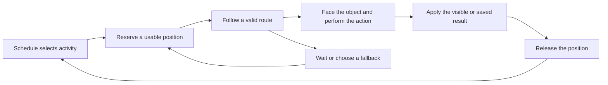

# Living worlds and an expanded level editor for The Lantern Atlas

Design proposal · 11 October 2026 · Baseline reference `1b84904` · Terrain format from `b9170fb` · Latest main integrated at `ce8de50`

The Lantern Atlas can feel substantially more alive by connecting residents, places and objects into understandable daily activity. A courier should collect a parcel, carry it through the town and leave it at a stall. A vendor should prepare the stall, serve customers and pack up. Rain should send people toward shelter. The player should see the causes and results of these actions, and be able to use German in situations that make sense.

The strongest approach is to build on the existing painted world, navigation, day/night rendering and story systems. Add a development level editor that uses the actual game renderer; put visible objects, collision, interaction points and activity positions into one consistent scene format; then use that editor to produce larger districts and resident routines. Keep Tiled available for geometry and interchange.

The expansion must satisfy both requirements: **at least twice the width and twice the height, and at least twice the connected explorable area in each of the 13 outdoor maps**. The target footprint is therefore at least **3072 × 2048 world units**, giving four times the current rectangular area. The three story towns are the first production milestone; the ten expeditions remain part of the expansion scope. Interiors gain independent dimensions and the same authoring tools, while their size follows the activities they need to support. Doubling every interior is outside this assumed outdoor scope.

This document specifies the intended design and acceptance targets. See [implementation status](living-world-implementation.md) for the working foundation and remaining work. The report and accompanying area audit do not themselves change the playable maps.

## Baseline: what the game already provides

This section describes the baseline at `1b84904`, with terrain updated to `b9170fb`. The [implementation status](living-world-implementation.md) records changes made since the proposal. The existing implementation contains much of the visual foundation. The principal gaps are coordinated behavior and a complete authoring workflow.

| Area | Current implementation | What needs to change |
| --- | --- | --- |
| World size | All 13 outdoor regions use a 1536 × 1024 logical footprint. Latest main assembles 6144 × 4096 story-town artwork from bounded detail pieces, displayed at the old world size. | Introduce dimensions per map and add new traversable districts. Higher texture resolution alone does not enlarge the world. |
| Visible scenery | 276 separately placed props across the story towns, plus 114 in each expedition. Props have stable IDs, foot anchors, sizes, variants and collision footprints. | Expose those instances in a visual editor and attach usable activity positions to them. |
| Existing editor | CLI export/import to Tiled for walkable polygons, obstacles, spawn and existing NPC/interaction positions in the three story towns. | Add scenery, reusable groups, generation, resident schedules, doors, sound zones and all expedition maps. |
| Ambient residents | Three walking residents per story town and eight per expedition, following collision-aware routes with pauses. | Give routes purposes, destinations and visible actions; add reactions and small social encounters. |
| Named cast | Time-dependent barks and small movements around fixed interaction anchors. | Bind work to real objects and support movement without losing story access or server proximity checks. |
| Atmosphere | Day/night artwork, lighting, rain, mist, scenery animation, regional audio and accessibility settings. | Connect effects to districts, surfaces, work and weather responses. |
| Story and learning | Persistent quest consequences, evidence, dialogue, language practice and server-checked rewards. | Express more saved consequences through visible changes and context-specific everyday activity. |
| Runtime scaling | View culling, destination asset loading/release and frame telemetry. | Add spatial indexing and chunk residency; stop processing every distant instance every frame. |

The current editor’s **Objects layer contains interaction markers**, such as receipts and noticeboards. It does not edit the visible trees, houses, stalls or benches around them. Those live in separate placement definitions. Its reference painting also excludes the raised scenery whose foundations affect navigation. This means a designer cannot yet reliably see, move and validate the complete scene in one place. See the [editor guide](map-editor.md), [Tiled adapter](../scripts/map-editor-format.mjs), [placed scenery definitions](../web/src/placed-scenery.ts) and [map placement adapter](../web/src/map-authoring.ts).

The current import validation is useful and should be retained. It checks geometry, identifiers, bounds and reachable approaches before replacing the canonical file. The new editor should extend those checks to the whole scene. It must also define deletion explicitly: today, omitting an authored interaction placement can leave the original content position active through fallback behavior.

## What should make the worlds feel alive

### Everyday activity with visible results

Each populated district should have a small number of recognizable routines. Start with deliveries, serving customers, reading, gardening and repair work. Reuse these behaviors across different locations while varying the characters, objects and conversations.

A useful scene has a short causal chain: a delivery arrives, a vendor moves a crate, the display becomes stocked, and a customer approaches. A bench becomes occupied because someone has finished an errand. A repair changes the lamp’s appearance. These chains make the town understandable without requiring a large economic simulation.

Give a resident an identity, home or arrival point, occupation, work location, preferred social place and a few schedule blocks. Add one distinguishing habit, such as checking the timetable before work or visiting the same garden after lunch. Variations should be seeded and bounded so residents remain recognizable.

### Objects that support activity

An object needs more than a picture and a collision shape. It should describe what a resident or player can do there. These usable positions are often called *affordances*; the editor should label them plainly as seats, work positions, pickup points or service positions.

| Object | Activity positions | Visible behavior | Important rule |
| --- | --- | --- | --- |
| Bench | Two seats, approach and exit positions | Sit, read, talk, stand | Reserve individual seats; leave the walking route clear. |
| Market stall | Vendor position, customer position, short queue | Prepare, serve, pay, pack | Keep the public route and story approach open. |
| Parcel depot | Pickup, sorting and delivery positions | Collect, carry, set down | Link the parcel state to the task result. |
| Garden bed | Watering and inspection positions | Water, tend, inspect | Place the actor on accessible ground beside the bed. |
| Workshop | Tool position and visitor position | Repair, inspect, hand over | Use the appropriate pose and held object. |
| Door | Outside approach, inside arrival and return position | Enter, leave, knock | Validate both destinations and opening conditions. |
| Shelter | Several waiting positions | Gather during rain, depart afterward | Cap occupancy and provide overflow destinations. |

Moving a bench in the editor should move its artwork, footprint, seats, approaches and associated sound origin together. A resident refers to the bench’s stable ID and seat name, rather than a copied pair of coordinates that becomes stale.

### A small behavior system

Use an authored task system with these basic stages:



A task specifies its destination, allowed time window, duration, pose, facing, held object, conditions and fallback. Start with travel, wait, sit, read, carry, serve, work, greet and shelter. Add new actions only when a scene needs them.

Use an explicit interruption order: active player conversation, required story event, immediate obstruction or weather response, scheduled work, then optional ambient activity. Every reservation needs an expiry and release path. A blocked approach should lead to another seat, a waiting point or a cancelled optional task, rather than an actor standing forever in the street.

Small social interactions should reserve positions for both participants. A customer and vendor can face one another, exchange a line and complete a transaction together. Their animation and event phase must agree. Begin with short authored exchanges rather than unrestricted conversational agents.

### Time and change without frustrating the learner

Opening hours should change the scene: shutters, lights, stock, staff positions and available side activities. Required story characters must remain findable. Provide an alternate meeting point, a clear destination hint or a reachable after-hours conversation. Once a conversation begins, let it finish even if the schedule boundary passes.

Avoid visibly teleporting a required character back to an old anchor. Reserve their current valid conversation position, have them finish a short movement, or guide the player to an alternate authored location. The server must validate the same location the player sees.

A twelve-minute game day compresses an hour into 30 real seconds. Schedule windows therefore need generous interaction grace periods. Optional events may repeat, but a learner should not miss a mandatory objective because they were reading slowly.

World consequences should include repaired lamps, updated notices, delivered crates, changed routes and residents acknowledging an earlier agreement. Preserve the existing separation between account learning progress, personal story state and the shared world clock.

### Sound and language attached to the scene

Add positioned fountain water, workshop tools, a station arrival bell, kettle sounds and subdued conversation around active gathering spots. Distance and district boundaries should control volume. Limit simultaneous sounds and preserve dialogue ducking and mute support. Regional audio exists already; [world-audio.ts](../web/src/world-audio.ts) is the starting point.

Use short German lines that describe observable activity: “Das Paket ist schwer” while lifting a parcel, or a price question at the stall. Keep the story’s vocabulary, reveal order and support-language rules. Existing learner-specific review barks can remain local presentation, while shared physical behavior remains consistent. Watching an action counts as exposure, never as proof that a word has been learned.

Reduced motion should simplify animations and camera movement without disabling access to gameplay. Today, the setting can freeze background routines. Once residents carry meaningful tasks, task state must still advance, with calm transitions or accessible alternate interactions.

## Expanding every outdoor map by at least 2x

### Dimensions and acceptance

World units describe gameplay distances. Texture pixels describe artwork detail. Keep these independent so expansion does not enlarge characters, stretch buildings or change walking speed.

| Layout | Logical dimensions | Rectangular area | Increase over current |
| --- | --- | ---: | ---: |
| Current outdoor map | 1536 × 1024 | 1,572,864 square world units | 1× |
| Required expanded map | At least 3072 × 2048 | At least 6,291,456 | At least 4× |

The 3072 × 2048 footprint preserves the current aspect ratio and provides room for several new neighborhoods. It must pass the connected-area requirement separately. Water, foundations and inaccessible decoration do not count as explorable area. If the reachable-area check fails, increase usable district space or add another chunk. Aim to preserve each region’s existing balance of usable land and scenery, which would bring connected area toward four times its baseline; twice the connected area is the minimum acceptance floor.

Keep existing districts at their original physical scale. Prefer retaining their coordinates for the first expansion, extending east and south. If the composition needs a new district north or west, give the old district an explicit offset and migrate all dependent coordinates together.

### Measured baseline for the expansion

The following baseline uses the current navigation grid at 14-world-unit spacing, including scenery foundations. Flood-fill starts from the spawn-connected component and follows the runtime’s collision and diagonal movement rules. Area is **connected cell count × 196**, a repeatable sampling proxy rather than an exact polygon-union measurement. Use the same grid origin, spacing and edge rules for the expanded maps.

| Map | Connected cells now | Approximate connected area now | Minimum expanded connected area |
| --- | ---: | ---: | ---: |
| Lindenhafen | 1,628 | 319,088 | 638,176 |
| Waldruh | 1,614 | 316,344 | 632,688 |
| Nebelstadt | 1,413 | 276,948 | 553,896 |
| Saffron Court | 1,817 | 356,132 | 712,264 |
| Rain Arcade | 1,796 | 352,016 | 704,032 |
| Windplain | 4,512 | 884,352 | 1,768,704 |
| Riverweave | 2,070 | 405,720 | 811,440 |
| Terracielo | 1,779 | 348,684 | 697,368 |
| Sunpatch | 2,679 | 525,084 | 1,050,168 |
| Kigalights | 1,959 | 383,964 | 767,928 |
| Cedar Bay | 1,843 | 361,228 | 722,456 |
| Seoul Steps | 1,937 | 379,652 | 759,304 |
| Dune Garden | 2,015 | 394,940 | 789,880 |

Areas are square world units. The [baseline data](audits/living-world-area-baseline.json) records the counts and method. Lindenhafen has 61 other walkable sampled cells outside the spawn component, and Nebelstadt has nine; these are excluded from the baseline. A larger disconnected patch must not pass the expansion check.

The accompanying [measurement script](audits/measure-living-world-baseline.mjs) reproduces this snapshot from the repository root:

```sh
node docs/audits/measure-living-world-baseline.mjs . /tmp/lantern-atlas-map-area-baseline.json
```

The measurement now uses the supported `NavigationGrid.auditConnectedArea` API and each canonical scene's dimensions, retaining the same sampling rules. It refuses to overwrite the immutable baseline. Run `npm run worlds:check-expansion` to require doubled width, doubled height and doubled spawn-connected cell count independently for every original map. That acceptance check remains separate from ordinary regression tests and currently fails until the actual expansions are authored.

Measure the ratio at equivalent progression states. The first full-region unlock should expose twice the previous connected area; later quest locks should not be used to disguise disconnected expansion. Also check entrances, exits and required routes individually, since an area total cannot establish that important destinations are usable.

### Districts worth adding

The larger maps need new reasons to explore. Each addition should contain a destination, a local activity, a quiet observation spot, an optional language opportunity and a connection back to the existing town. Preserve short main-story routes and provide signed shortcuts once a district is discovered.

| Story town | Proposed expansion | Daily activity | Connection to the story |
| --- | --- | --- | --- |
| Lindenhafen | Canal promenade, parcel yard and residential market lane | Deliveries, café customers, market setup, evening departure | Parcels and revised timetables make the missing railway tangible. |
| Waldruh | Mill service yard, woodland loop, garden and inn courtyard | Repairs, gardening, archive visits and evening gatherings | Conflicting clocks appear in work and travel routines without blocking progress. |
| Nebelstadt | Working quay, sheltered warehouse lane and lighthouse approach | Dockside deliveries, signal maintenance and storm preparation | Repair and council decisions change notices, equipment and gathering places. |

The ten expeditions should reuse the editor and behavior system while retaining their individual activity themes:

| Expedition | Proposed addition |
| --- | --- |
| Saffron Court | A connected workshop courtyard and delivery lane with garden access. |
| Rain Arcade | A parallel sheltered lane and collection area with visible opening-hour changes. |
| Windplain | Another camp work area and landmark loop; preserve purposeful open space and wayfinding. |
| Riverweave | A second landing and kitchen route, with safe bank connections and delivery handoffs. |
| Terracielo | A terrace work yard and accessible route linking commission stages. |
| Sunpatch | A mural preparation court and neighborhood radio gathering space. |
| Kigalights | Another studio court and a legible route to an evening screening. |
| Cedar Bay | A ferry waiting garden and reading-room approach with weather alternatives. |
| Seoul Steps | A shared courtyard and additional rooftop-garden connection with clear entrances. |
| Dune Garden | A second irrigated garden circuit where gate and watering states are visible. |

Validate these additions against the established community stories and art direction. Repeated behavior modules should not turn every place into the same market scene. Expansion also does not require doubling every NPC or prop count: density should follow the activity and available circulation space.

### Terrain chunks and artwork

Use 768 × 512 logical chunks as an initial production unit. The current footprint becomes a 2 × 2 layout; the expanded footprint becomes 4 × 4, adding twelve chunk areas around the four existing core chunks. Use the latest main terrain format at **four texture pixels per world unit**. Each 768 × 512 logical chunk has a 3072 × 2048 visible texture frame plus a one-pixel sampling guard at adjoining edges. Latest main already renders the original district as four such core chunks, representing a 6144 × 4096 painting without changing its physical scale. A complete expanded terrain at this density corresponds to **12288 × 8192 painting pixels**, delivered as sixteen bounded chunks per lighting state. Keep newly generated close-up sections at the native detail density documented in [the terrain-detail source workflow](../art/source/terrain-detail/README.md); a large low-resolution layout image is only a planning reference, not final artwork.

Render those chunks as one continuous town with shared coordinates and navigation. A chunk boundary should not require a loading screen or a new multiplayer region. Load the visible area plus a measured prefetch margin, and release distant textures when no renderer or transition still references them. Existing expedition core art has a lower texture density. Preserve its physical scale; new expedition terrain also follows the requested four-pixel detail format, with a visual transition review at core boundaries.

Author routes and water boundaries before final terrain painting. Use neighboring plates as references, preserve registered borders and keep raised objects separate. The existing [terrain stitching utility](../scripts/terrain-stitch.mjs) and [terrain source workflow](../art/source/terrain-hd/README.md) provide useful groundwork. Seams still require visual inspection for doubled curbs, discontinuous banks, mismatched lighting and paths that disagree with navigation. Export edge padding or equivalent sampling protection to avoid visible lines between texture chunks.

## A level editor that makes object work easy

### The main authoring surface

Build a development-only editor around the same Phaser rendering components used by play. It should show the actual day/night art, depth sorting, collision bases, lighting and characters. Reuse the game’s scene model and renderer through a small editor adapter; avoid creating a second independent rendering implementation.

The initial audience is a designer or developer authoring local project content. A publicly accessible player creation tool would additionally need accounts, content permissions, publication and moderation workflows, and is a separate product scope.

| Part of the editor | Designer experience |
| --- | --- |
| Asset browser | Searchable thumbnails for buildings, plants, props, characters and reusable groups; filters by region, activity and size; recent and favorite items. |
| World canvas | Pan, zoom, click-select, drag, marquee-select, duplicate, copy/paste, optional snapping, brush placement and erase. |
| Inspector | Clear controls for size, permitted facing/flip, appearance, collision, interaction content, activity positions and sound. |
| Layers and outliner | Named districts and groups, hide/lock controls, find-by-name and frame-selection; locked terrain stays out of the way. |
| Simulation controls | Play here, pause, time scrubber, weather and story-state preview; return to the same selection after playing. |
| Validation panel | Click a warning to focus the exact blocked route, missing reference, invalid doorway or unavailable activity position. |

Ordinary placement should be three actions: find a thumbnail, drag it into the scene, adjust it. Sensible defaults must supply the foot anchor, collision, size and available activity positions. Avoid making the designer type asset IDs or create basic polygons for every tree.

Use familiar shortcuts: undo/redo, duplicate, delete, escape, space-drag to pan and a focus-selection command. Multi-object transforms, prefab placement and generation must each be one undoable transaction. Autosave recoverable drafts separately from validated game content. Save/reload must preserve stable IDs, grouping and selection-relevant metadata.

Painterly sprites cannot always rotate freely without breaking perspective. Offer only supported orientations and variants; distinguish rotating a ground footprint from inventing a new painted view. Constrain scale variation to the asset’s approved range.

### Reusable objects and groups

An asset catalog describes a reusable object: its image or animation, physical size, foot pivot, collision footprint, supported variants, tags and optional behaviors. An instance describes a particular object in the town, with a stable ID and local overrides.

A prefab is a reusable group. Initial examples should include a café terrace, market corner, parcel depot, garden patch, forest cluster, harbor work area and sheltered bench. A market corner can contain a stall, vendor and customer positions, a queue, signs and crates, with an open circulation corridor.

Place the whole group in one action. Allow the designer to move its children, replace a crate, lock an instance or detach the group. Changes to a prefab should offer a preview of affected instances and preserve explicit local overrides. Deleting a referenced seat, door or work position must identify the affected schedules and require a valid replacement or task removal before publishing.

### Generate an area and keep control of it

“Generate” should primarily mean populate a selected area using existing approved assets. That is the fastest route to useful world-building.

1. Draw or select an area and choose a preset, such as woodland edge, garden or market.
2. Set density, minimum spacing, size variation and the asset palette. Advanced settings can expose the seed and placement weights.
3. Respect terrain tags, water boundaries, slope or terrace tags, reserved paths, door approaches and story interaction space.
4. Show a temporary preview with proposed instances and any placement failures.
5. Accept, regenerate, reduce density or paint exclusions.
6. Edit every accepted object individually. Pin important objects and regenerate only the remaining generated subset.

The generator should first place intentional anchors, such as stalls or benches, then supporting objects, then small decoration. Use minimum-distance sampling for natural scatter and deliberate spacing along curves for lamps or fences. Do not distribute everything uniformly. A town benefits from busy centers, quieter edges and readable landmarks.

Store a seed, generator version, rules, palette version, zone and ownership of generated instances. Also store the accepted instance results. Reopening a map should load what the designer approved rather than rerunning a changed generator. Regeneration should preview a difference, preserve pinned or manually overridden instances, and never erase unrelated authored objects. If constraints cannot be satisfied, explain the conflict instead of silently overlapping objects or filling waterways.

Generation can propose activity positions and routine assignments from validated prefabs. New story characters, dialogue and learning tasks still require authored content and review. A generated decoration needs no dialogue record; a generated interaction must reference a valid content record or remain clearly marked as an incomplete draft.

### Create new art as a separate workflow

An optional Create asset workflow can accept an imported image or request generated artwork. The job should complete in the background and appear in a review tray. The designer then checks transparency, perspective, scale, day/night treatment, pivot and collision, before adding it to the reusable catalog.

Require source provenance and export metadata. An accepted asset must produce registered runtime frames and thumbnails through the existing asset pipeline. Asset generation does not automatically create collision, trustworthy dialogue, animation continuity or server-authoritative behavior. Start the editor with the existing library so placement and generation are useful before this art workflow exists.

### Author residents and events visually

Select a resident, choose home and work objects, and create schedule blocks on a timeline. Drag route stops only where a particular path matters; otherwise derive paths between activity positions. Show route arrows, reserved slots, queue capacity and fallback locations.

A “Why is this resident waiting?” inspector should show the chosen task, required conditions, destination, reservation and failure reason. This is essential once multiple actors share a small space.

For events, provide an ordered list of phases such as gather, arrive, exchange, disperse. Each phase chooses participants, positions, actions and conditions. Scrubbing time should preview the event without awarding learning credit, advancing a real save or sending gameplay writes to the production server.

### Retain Tiled with a clear contract

Tiled already supports object templates with inherited properties, custom classes and enums, and multi-map world layouts. These can provide useful interchange and geometry authoring, but the current importer does not understand them automatically. Extend and test the adapter explicitly. See the official [template documentation](https://doc.mapeditor.org/en/stable/manual/using-templates/), [custom properties](https://doc.mapeditor.org/en/stable/manual/custom-properties/) and [world layout documentation](https://doc.mapeditor.org/en/stable/manual/worlds/).

Add scenery image objects and typed layers for interactions, activity positions, routes, doors and zones. Resolve templates and permitted overrides during import. Define conversions between Tiled image alignment and the game’s foot pivots. Ensure the reference image is displayed at logical map scale: the current adapter points at terrain that now has twice the logical resolution, without an explicit scale conversion.

Keep one canonical scene format. Tiled files are an exchange/editing surface; they must not become an independently maintained competing source. Supported properties must survive roundtrip. Unsupported properties should produce a clear error or be retained in a documented extension field, never disappear silently.

Tiled Automapping is useful for rule-based terrain and repetitive details, but it does not by itself provide the proposed semantic population system. Its documentation also describes limitations when matching object output. Use a dedicated population generator for connected prefabs, access clearance and pinned-instance behavior. See [Automapping](https://doc.mapeditor.org/en/stable/manual/automapping/).

## Data and runtime architecture

### One scene definition and a shared compiler

Introduce a versioned scene document per map. It should contain bounds, terrain chunks, district definitions, scenery instances, navigation, interactions, doors, resident schedules, activity positions, audio zones and events. Keep narrative and learning content in their existing validated catalogs and reference it by ID.

| Record | Essential data |
| --- | --- |
| Map | Stable map ID, schema/content version, width, height, coordinate origin and spawn. |
| Terrain chunk | ID, world rectangle, art density, surface tags, day/night asset references and neighbors. |
| Asset or prefab | Stable ID, artwork, pivot, base size, footprint, variants, child objects and activity defaults. |
| Instance | Stable ID, asset/prefab reference, transform, local overrides, conditions and generator ownership. |
| Interaction | Content ID, owner instance, approach position, usable distance and availability conditions. |
| Resident | Identity, appearance, home/work references, schedule, task set and fallback. |
| Event | Trigger/window, participants, phases, conditions, repeat rule and persistent effects. |
| Generation zone | Shape, exclusions, palette, seed, rules version and pinned instance IDs. |

The compiler resolves defaults, prefab inheritance and coordinates, validates references and reachability, and emits browser scene data, server interaction data, navigation metadata, previews and asset manifests. Editor drafts and released game data must remain distinct. The browser and server should identify the same compiled content version.

Editor Save should call a development-only local authoring service that validates the submitted scene, stages canonical files and compiled outputs, then replaces them as a coherent version and returns diagnostics. Restrict it to the project’s authoring paths and disable it in production. Keep recoverable drafts separate so a failed validation or compiler run cannot replace working game content. This completes the browser-to-project save workflow without requiring manual JSON downloads.

Use deterministic serialization and separate maps into manageable files so ordinary object movement produces readable diffs. Prefer explicit world coordinates for scene geometry. Keep units in field names where ambiguity is possible, and record any origin offset in the migration.

### Dimensions must propagate through the full game

Changing two global constants is insufficient. The current code mixes pixel positions with normalized positions, and several systems independently assume the old footprint.

| System | Required migration | Existing entry points |
| --- | --- | --- |
| Map schema and editor | Dimensions per map; schema version; expanded layers; independent interior bounds. | [map-authoring.ts](../web/src/map-authoring.ts), [map-editor-format.mjs](../scripts/map-editor-format.mjs), [interiors.ts](../web/src/interiors.ts) |
| Rendering and camera | Read active scene bounds; preserve character scale; handle chunk terrain and camera limits. | [world.ts](../web/src/world.ts), [world-camera.ts](../web/src/world-camera.ts) |
| Navigation | Size the grid per scene; preserve cell size, continuous segment checks and collision rules. | [navigation.ts](../web/src/navigation.ts) |
| Residents and expeditions | Convert normalized route nodes once; migrate absolute scenery and land polygons consistently. | [world-life.ts](../web/src/world-life.ts), [expeditions.ts](../web/src/expeditions.ts) |
| Atmosphere and audio | Cover the active view/district instead of fixed old-world extents. | [world-atmosphere.ts](../web/src/world-atmosphere.ts), [world-audio.ts](../web/src/world-audio.ts) |
| Travel and saved positions | Migrate normalized positions, edge clamps, spawn tables, door approaches and reconnect restoration. | [world.ts](../web/src/world.ts), [world.go](../server/world.go), [world_interiors.go](../server/world_interiors.go) |
| Server validation | Express speed and interaction distance in world units; derive authority data from the scene compiler. | [world.go](../server/world.go), [story_state.go](../server/story_state.go), [export-world-content.mjs](../scripts/export-world-content.mjs) |

For an old normalized coordinate `(u, v)`, first recover `(u × 1536, v × 1024)` world units. Add any explicit core offset. Only then convert to the new representation. With the target dimensions and no offset, a normalized wire representation would become `(u / 2, v / 2)`. Keeping the old normalized numbers would double every position’s distance from the origin and separate those positions from preserved scenery.

The client currently moves at 225 world pixels per second and uses a 140-pixel interaction radius, while server movement credit and several proximity checks use normalized distances. Replace those assumptions together and calibrate a shared world-unit contract. Do not multiply all tolerances by one guessed factor. Static evidence and moving NPCs need separate correctly located authority records.

Version saved positions and reconnect payloads. Translate valid old positions; project invalid positions to a nearby reachable point or the correct map spawn. Retain earned quests, learning progress and inventory. Compile the server spawn registry as well as interaction points so another hardcoded table cannot drift. During deployment, reject or refresh incompatible client/content versions with a recoverable reconnect path.

### Time and multiplayer authority

Separate state ownership before making residents interactive.

| State | Owner and persistence |
| --- | --- |
| Static scene and schedules | Versioned authored content distributed to both runtime and server. |
| Shared time and events | Server clock/epoch and event state; persist important state across restarts. |
| Shared usable objects and NPC interactions | Server-owned reservations, event phases and accepted effects. |
| Personal narrative and learning | Existing account progress, story flags, evidence and learning records. |
| Visual effects | Client particles, sway, camera and presentation preferences. |

The existing shared clock is useful, but residents currently sample local elapsed time and do not have shared interaction identities. A shared sky does not guarantee matching resident positions. For predictable ambient tasks, sample from a common epoch, world time, map seed and content version. Reconstruct distant state directly rather than simulating every missed frame.

Use server timestamps and smooth clock corrections. If shared events must survive a restart, preserve the epoch or equivalent time state; the current server clock starts with the process. Manual/local time can remain in editor or watch previews, but it must not let a client open a shared shop or bypass an event condition.

Keep purely decorative residents inexpensive and deterministic. Promote actors to server-tracked state only when they participate in a shared interaction or event. Bound reservation updates and send nearby clients the relevant changes. Important effects need idempotent event IDs so reconnects and retries cannot deliver the same parcel or reward twice.

Personal story consequences can change the player’s dialogue and presentation. If players at different story stages share a region, do not give them contradictory solid geometry in the same shared space. Use common collision, or explicitly separate instances for incompatible world states. Preserve the existing decision that sleeping advances a personal story day rather than everybody’s world clock.

## Performance and production limits

Area growth should not require proportional work every frame. A spatial index should provide nearby scenery, actors, interactions and audio sources. Instantiate and animate the visible set plus a margin; sample medium-distance tasks less often; retain only schedule state for distant residents. Reuse route results until geometry or task destinations change.

At the existing 14-unit cell size, the full rectangular navigation lattice grows from 8,140 cells to 32,340 with the target dimensions. That size alone does not justify replacing the whole pathfinder. Profile it first, then add cached paths or a district-level route graph if path requests become a bottleneck. Preserve exact segment checks around narrow obstacles.

Texture memory deserves a separate budget from compressed downloads. A 3072 × 2048 visible RGBA8 chunk is approximately 24 MiB before guard pixels, copies or mipmaps. At the requested four pixels per world unit, retaining all sixteen expanded-map chunks costs approximately 384 MiB per period; both periods would approach 768 MiB. The original four-piece core is approximately 96 MiB per period. Splitting images saves memory only when distant chunks are actually released. Keep shared atlas references alive until all users have released them.

The existing distribution checks cap individual art files at 2 MiB, each story town’s art at 36 MiB and total art at 160 MiB on latest main. These are delivery constraints, not measurements of decoded GPU memory. Preserve the base-art caps. The first implemented addition now has separate accounting: at most 4.5 MiB per registered expansion chunk (two ≤2 MiB details and two ≤256 KiB overviews), up to twelve new chunks per map. The resulting theoretical ceiling is 702 MiB of new static art across all thirteen maps, so delivery size grows substantially even with bounded camera-local memory. Current three-chunk delivery is 12.40 MiB. Unregistered expansion files fail the budget. Further work should measure network cost and eliminate redundant assets without reducing the requested source detail. See [check-budgets.mjs](../scripts/check-budgets.mjs) and [frame telemetry](../web/src/world-performance.ts).

Agree on representative desktop and mobile devices before setting a release bar. Proposed initial targets are a stable 60 fps on the desktop reference device, 30 fps on the mobile reference device, p95 frame times near 16.7/33.3 ms respectively, and no sustained memory increase after repeated travel. Record loading transitions separately from steady exploration and report spikes as well as averages. These are goals to verify, not current measured performance.

Profile dense market scenes, rain, dawn/dusk transitions, camera movement across chunk boundaries, repeated region revisits and editor generation. Add counters for loaded texture pixels, active actors, path requests and instantiated objects. Cap work from a generator or navigation rebuild so editing remains responsive; larger jobs can run in a worker.

## Delivery plan

### First milestone with a complete playable district

Build one expanded Lindenhafen market/depot district using the actual editor. Include a courier, a vendor/customer exchange, a usable bench, a rain shelter, a visible parcel result and one optional contextual German interaction. Keep every existing story destination accessible.

This milestone should demonstrate the whole path: open a map, stamp a group, generate supporting scenery, edit an object, assign an activity, preview the day, validate, save and play. A tool that only produces attractive layouts without valid interactions is incomplete.

| Phase | Deliverable | Completion gate |
| --- | --- | --- |
| 1 — Scene foundation | Versioned scene format, per-map dimensions, asset catalog, legacy data conversion and shared compiler. | Existing maps retain their appearance, scale, collision and server interaction positions after conversion. |
| 2 — Core editor | Palette, placement, selection, inspector, grouping, undo/redo, drafts, validation and play preview. | A designer can place, move, duplicate and delete visible objects without editing TypeScript. |
| 3 — Generation and expansion | Prefabs, constrained population, pinned instances, chunks and expanded Lindenhafen. | Lindenhafen reaches at least 3072 × 2048, passes the 2× reachable-area check and retains all existing story paths. |
| 4 — Resident activity | Usable positions, reservations, schedules, task poses, rain reactions and a small event. | A full-day preview has coherent tasks, no stuck actors and reliable story access. |
| 5 — Story-town production | Expanded Waldruh and Nebelstadt, regional activities, art, audio and authored language. | All three story towns pass area, content, accessibility and performance gates. |
| 6 — Expedition production | Migrate and expand all ten expedition maps using the same tools and distinct local activities. | Every outdoor map individually passes the expansion requirement. |

The editor, runtime and compiler are engineering work. District layout, terrain seams, suitable action poses and language content require separate art and content work. Staff these streams together after the scene contract stabilizes. The first complete district should establish actual production throughput before committing to calendar estimates for all 13 maps.

Prioritize existing asset reuse, reliable object editing and one coherent activity chain. Elaborate simulation, unrestricted procedural quests, large social AI systems and a public creator marketplace can wait until the core authoring workflow proves useful.

## Acceptance criteria

These checks define the intended result and keep “lifelike,” “larger” and “easy” measurable.

| Area | Required evidence |
| --- | --- |
| Map expansion | Each outdoor map reaches at least 3072 × 2048 world units and at least 2× its recorded spawn-connected area under the same measurement rules, with unchanged actor/object scale. |
| Useful new space | Every new district has a meaningful destination, readable connection, local activity and optional reason to explore. Required story routes remain convenient. |
| Basic editing | After brief onboarding, a designer can place and adjust a lamp in about 15 seconds, and populate/revise a small courtyard in about two minutes. Treat these as usability targets to test with a designer. |
| Object coherence | Moving a prefab updates its artwork, collision, approaches, usable positions and sound origins. Deletion exposes broken references before export. |
| Generated results | Same seed and rule version reproduce the same proposal. Accepted results remain individually editable. Pinned and unrelated authored objects survive regeneration. |
| Editor reliability | Undo/redo restores whole operations. Autosaved drafts recover after interruption. Save/reload preserves IDs and supported fields. Invalid exports leave released content unchanged. |
| Tiled interchange | Supported scene fields roundtrip without loss; image scale/pivots match the game; unsupported features are reported clearly. |
| Resident behavior | Full-day and weather previews show purposeful travel and actions, reservation release, interruption recovery and no required NPC becoming inaccessible. |
| Shared state | Two clients agree on gameplay-relevant actor/event state. Reconnects, retries and restarts preserve important effects without duplicating rewards. |
| Learning and story | New dialogue respects reveal order and language constraints; silent play and support languages remain usable; ambient exposure does not award mastery. |
| Accessibility | Reduced motion, touch controls and slow reading remain compatible with schedules, doors and required interactions. |
| Runtime | Device profiles cover dense scenes, chunk crossings, day/night transitions and repeated travel; texture and object counts return to stable levels. |

Retain the existing navigation, map roundtrip, travel, scenery, clock and server story tests, then extend them for the new contracts. Add targeted migration fixtures, generator reproducibility checks, cross-chunk routes, reservation failure cases and client/server coordinate parity. Visual review is still necessary for art seams, perspective, occlusion and readable composition; geometry validation cannot establish those qualities.

The first release should make one promise concrete: a designer can build a larger, inhabited district by arranging usable objects, assigning understandable activities and previewing the result directly in the game. Completing that workflow makes expansion across the remaining worlds practical.
