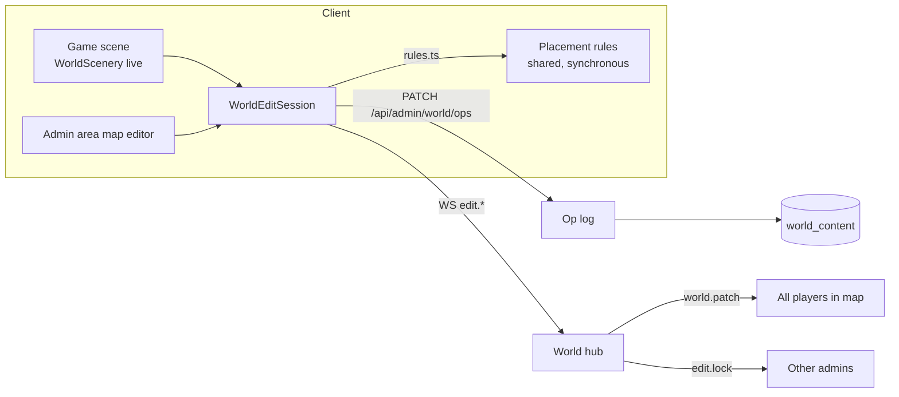

# Map editor redesign: handover report

Handover · 15 October 2026 · Baseline `d48c3739` (branch `claude/map-editor-redesign-c085b2`)

This report describes how world editing works today, why it fails admins, and the two editors that replace it:

1. **Edit mode**, embedded in the running game for admins. Buildings, props, doors and story anchors are moved, added and removed in place. Every committed action publishes immediately and streams to every connected player. One admin edits one object at a time. Admins can also hide lines from a character's monologue.
2. **Admin area**, reached from a renamed **Admin** button. It keeps the current analytics dashboard and adds a simplified map editor as a second section. The separate World Studio page goes away.

Decisions already taken with the product owner are listed in [Decisions](#decisions). Open design questions are at the end. All paths are relative to the repository root.

## Implementation status (15 October 2026)

All four phases are implemented on branch `claude/map-editor-redesign-c085b2`. Section 1 describes the system as it was before this work.

| Area | Where it lives |
| --- | --- |
| Shared placement rules, structured problems, size and room limits | [world-edit-rules.ts](../web/src/world-edit-rules.ts) |
| Edit operations, inverses for undo | [world-edit-ops.ts](../web/src/world-edit-ops.ts) |
| Incremental navigation grid | `NavigationGrid.withObstacles` in [navigation.ts](../web/src/navigation.ts) |
| Building-hosted rooms, document version 3, version 2 upgrade on read | [scene-schema.ts](../web/src/scene-schema.ts) |
| Compiler with structured problems; composition hints are warnings for admins | [scene-compiler.mjs](../scripts/scene-compiler.mjs), [admin-world-compiler.mjs](../scripts/admin-world-compiler.mjs) |
| Long-running edit worker | [admin-world-worker.mjs](../scripts/admin-world-worker.mjs), [admin_world_worker.go](../server/admin_world_worker.go) |
| Operations, locks, status, patch broadcast | [admin_world_ops.go](../server/admin_world_ops.go) |
| Story overrides: hidden and rewritten lines, the admin story listing | [story_overrides.go](../server/story_overrides.go) |
| In-game edit mode | [world-edit-mode.ts](../web/src/world-edit-mode.ts), [world-edit-overlay.ts](../web/src/world-edit-overlay.ts), `applyWorldEdits` in [world-scene.ts](../web/src/world-scene.ts) |
| Admin area map editor and Story tab | [admin-map-editor.ts](../web/src/admin-map-editor.ts), [admin-map-canvas.ts](../web/src/admin-map-canvas.ts), [admin-story.ts](../web/src/admin-story.ts), [admin-story-model.ts](../web/src/admin-story-model.ts), [admin-residents.ts](../web/src/admin-residents.ts) |

World Studio (`/editor.html`, the iframe overlay and all `level-editor*` modules) is deleted. The committed world was migrated to version 3; positions and the server coordinate file are unchanged apart from the content version.

Measured on the committed world, a warm edit is checked in 10 to 140 ms. The first edit in a town builds its grids in about 2 seconds, so the worker warms up as soon as an admin opens an editor. A full import still takes about 10 seconds.

Differences from the plan below, decided during implementation:

- **Nudging players** happens on each player's own client after a patch, not on the server. The server only rate-limits client movement and has no collision geometry.
- **Locks** are 30-second leases over HTTP, renewed every 10 seconds while an object is selected. They are not tied to the socket, so the admin area, which has no socket, uses the same leases. A closed tab frees its locks within 30 seconds.
- **Overlap** is checked as "an object would stand inside another object's base". Authored towns have trunks and walls that touch, and the stricter polygon rule refused undoing a deletion.
- **Undo of a deletion** sends a `place` with `restore: true`. It skips the shape checks, because it reinstates what existed, but routes are still checked.
- **Activity spots** are no longer authored by hand. A new object copies the spots of an existing object with the same artwork, scaled to its size. Open question 3 below is therefore partly answered: existing hand-placed spots stay as they are.
- **Story characters and evidence** must stand on, or right beside, ground connected to the arrival point, on both the player grid and the point-sized resident grid. This matches the old compiler's stricter check.
- **Rooms** can be hosted by any building with a painted door: today the inn, bakery and grocery houses. A town may still have only one room of each kind, because rooms are keyed by kind on the server.
- **Edit mode** is hidden on phone-width screens rather than below 768 px, using the shared `--phone` layout alias.

Not verified in a browser: the Phaser and DOM parts of both editors were checked by unit tests, type checks, lint and code review, but nobody has clicked through them yet.

---

## 1. What exists today

### 1.1 World Studio is a second application loaded over the game

- The HUD shows an **Edit** button to admins ([main.ts:348](../web/src/main.ts), handler at [main.ts:1874-1876](../web/src/main.ts)). It opens `WorldEditorOverlay` ([admin-world-editor.ts](../web/src/admin-world-editor.ts)), a modal `<dialog>` that embeds `/editor.html?map=<id>&embedded=1` in an iframe.
- `/editor.html` boots its own `Phaser.Game` with a single `LevelEditorCanvas` scene ([level-editor.ts:541](../web/src/level-editor.ts), [level-editor-canvas.ts:35](../web/src/level-editor-canvas.ts)). It reuses the play renderer classes (`WorldScenery`, `StreamedWorldTerrain`, `WorldMapAssets`) but is a second instance with its own asset loading.
- While the overlay is open the game is paused and input is disabled ([main.ts:708](../web/src/main.ts), [main.ts:724](../web/src/main.ts)). The admin cannot walk, and other players see the admin's avatar standing still.
- The iframe and the game talk through `postMessage` (`atlas:editor-state`, `atlas:world-saved`).
- The HUD also shows an **Analytics** link to `/admin.html` ([main.ts:349](../web/src/main.ts)), a third separate page ([admin.ts](../web/src/admin.ts)) that in turn links to `/editor.html`.

The editor UI is one 544-line file whose markup is a single `innerHTML` template ([level-editor.ts:483-488](../web/src/level-editor.ts)). Panels offered today: Layers (nine toggles), Object library with Objects, Groups and Placed tabs, Copy and Paste, Stamp, Brush and Erase with five settings, a palette, prefabs (capture, publish revision, preview update, detach, lock), an outliner with per-object hide and lock, a View section (grid, snap, day or night lighting, go to district), Generate objects (region, seed, count, spacing, clearance, palette, preview, apply), a canvas toolbar (Select, Box, Pan, Frame, zoom), an Inspector, Building entrances, Reusable group, Residents and daily activities, Validation and map statistics. Line counts:

| File | Lines |
| --- | ---: |
| `web/src/level-editor.ts` | 544 |
| `web/src/level-editor.css` | 951 |
| `web/src/level-editor-canvas.ts` | 322 |
| `web/src/level-editor-object-tools.ts` | 196 |
| `web/src/level-editor-prefabs.ts` | 194 |
| `web/src/level-editor-model.ts` | 154 |
| `web/src/level-editor-generation.ts` | 101 |
| `web/src/level-editor-residents.ts` | 89 |
| other `level-editor-*.ts` | 168 |
| tests | 772 |

### 1.2 The document model

The editor has no schema of its own. It edits `WorldSceneDocument` from [scene-schema.ts](../web/src/scene-schema.ts): `{version: 2, maps: Record<id, WorldScene>, prefabs?}`. Per scene:

| Field | Meaning | Editable in World Studio |
| --- | --- | --- |
| `scenery[]` | Every placed object, buildings included. A building is scenery whose asset is house, archive, cafe, station, workshop or greenhouse ([building-spacing.ts:35-37](../web/src/building-spacing.ts)). | Yes |
| `entrances[]` | Doors. `{id, ownerId, interiorId, offsetX, offsetY, returnOffset?}`, linked to a building by `ownerId`. At most one per interior per map. | Yes, as a separate panel |
| `activities[]` | Seats, work spots, queues, owned by scenery through `ownerId`. | Yes |
| `npcs[]`, `objects[]` | Story character and evidence anchors. IDs must match authored content exactly. | No |
| `residents[]` | Ambient residents with schedules. | Yes |
| `terrain[]`, `districts[]`, `navigation.terrainCollision[]` | Painted ground, district polygons, water and cliff collision. | No |
| `generationZones[]`, `prefabInstances[]` | Scatter batches and prefab copies. | Yes |
| `walkable[]`, `obstacles[]` | Legacy, must be empty for clear-land scenes. | No |

Two facts matter for the redesign:

- **The door position is already derived from the building art.** `sceneEntrancePoint` ([scene-schema.ts:127-134](../web/src/scene-schema.ts)) reads the painted `door` rectangle from `scenery-geometry.json` and ignores the authored offset whenever the asset has one. The offset survives only as a validation input (see 1.4), which is where the confusing door errors come from.
- **Interiors are four fixed rooms.** `cafe`, `bakery`, `supermarket` and `inn` are hardcoded on the server ([world_interiors.go:7-17](../server/world_interiors.go)) and in the schema ([scene-schema.ts:75](../web/src/scene-schema.ts)). Each region has one copy of each, with the same painted room and stations ([interiors.md](interiors.md)). A town cannot have two cafés.

### 1.3 Save is publish

- Endpoints ([app.go:112-115](../server/app.go)): `GET /api/admin/world`, `POST /api/admin/world/validate`, `PUT /api/admin/world` with `If-Match: "<revision>"`, and the public `GET /api/world-content`.
- There is no server-side draft. The only draft is `localStorage['atlas.world-studio.draft.v1']`. A successful PUT publishes to all players at once ([admin_world.go:325-338](../server/admin_world.go)).
- Conflicts: a process-wide write lock (409 "another world operation is in progress"), an `If-Match` revision check (409 "this world changed; reopen the editor"), and a compare-and-swap in the store whose failure surfaces as 409 "idempotency key was already used for another request" ([model.go:17](../server/model.go)), a message unrelated to world editing.
- Live servers poll the store every 5 s ([admin_world.go:146-165](../server/admin_world.go)). On a new `contentVersion` the server re-projects player positions and sends every client a fresh `map` message ([admin_world.go:376-406](../server/admin_world.go)). The client treats the version mismatch as incompatible, closes the socket, refetches `/api/world-content`, rebuilds the whole scene and reconnects ([api.ts:347-359](../web/src/api.ts), [main.ts:2433-2439](../web/src/main.ts)). This interrupts whatever the player was doing.

### 1.4 Why validation keeps failing

Validation runs by shelling out from Go to Node ([admin_world.go:109](../server/admin_world.go) → [scripts/admin-world-compiler.mjs](../scripts/admin-world-compiler.mjs) → [scripts/scene-compiler.mjs](../scripts/scene-compiler.mjs)) with `strictQuality = true`, so every "quality" heuristic is a hard error. All failures are joined with newlines into one string and returned as `{error: "..."}` with status 422 ([scene-compiler.mjs:196](../scripts/scene-compiler.mjs), [admin_world.go:121-131](../server/admin_world.go)). The client splits the string into lines ([world-editor-api.ts:23-24](../web/src/world-editor-api.ts)). No error carries an object ID, a position or a fix, and nothing in the canvas highlights the offender.

The rules that reject an ordinary building move or resize:

| Rule | Source | What triggers it |
| --- | --- | --- |
| Buildings need 32 units between painted bounds | [scene-quality.mjs:20](../scripts/scene-quality.mjs) | Dragging a building near another. The drag itself does not check this. |
| Height in persons must stay in the asset's canon range (house 2.6–3, café 3.5–4.5 …) | [scene-quality.mjs:30](../scripts/scene-quality.mjs), [scene-schema.ts:25-29](../web/src/scene-schema.ts) | Typing a width in the inspector. |
| Source density below 3.5 px/unit | [scene-quality.mjs:35](../scripts/scene-quality.mjs) | Enlarging an object. |
| Each terrain chunk needs 18 objects, two buildings or a landmark, 15% walkable ground and an activity owner | [scene-quality.mjs:45-48](../scripts/scene-quality.mjs) | Moving a building across a chunk boundary fails the chunk it left. |
| Every NPC, object, door approach, door return and activity slot must be reachable from spawn with 10 units of clearance | [scene-compiler.mjs:117-124](../scripts/scene-compiler.mjs), [scene-compiler.mjs:160](../scripts/scene-compiler.mjs), [scene-compiler.mjs:172](../scripts/scene-compiler.mjs) | A footprint that narrows a street, or a door that lands on a hedge. |
| Entrance must lie inside the painted door rectangle, checked for both the derived point and the stored offset | [scene-compiler.mjs:153](../scripts/scene-compiler.mjs) | The inspector's default offset (0, 32) rarely falls inside a given asset's door. The derived point is fine, the stale offset is not, and the message does not say which. |
| Entrance owner has no painted door, or door smaller than 1.1 persons | [scene-compiler.mjs:149](../scripts/scene-compiler.mjs), [scene-compiler.mjs:154](../scripts/scene-compiler.mjs) | Assigning a room to a tree or a small house. |
| Each story town must have cafe, bakery, supermarket and inn entrances | [scene-compiler.mjs:145](../scripts/scene-compiler.mjs) | Deleting a storefront, or removing an entrance to move it. |
| Story anchors must match content, no additions or deletions | [scene-compiler.mjs:59-60](../scripts/scene-compiler.mjs) | Not editable anyway. |
| Changed bounds need a higher `coordinateVersion` | [admin_world.go:366](../server/admin_world.go) | Not editable anyway. |

About 95 further structural checks live in `parseWorldSceneDocument` ([scene-schema.ts:244-439](../web/src/scene-schema.ts)); they are sound and mostly unreachable through the UI. The client runs none of the table above during a drag, so the admin learns about a failure only on **Save world**, as a wall of text.

### 1.5 Multiplayer transport

- One WebSocket per player ([world.go:147](../server/world.go), library `coder/websocket`). Rooms are keyed by `mapId`; players in interiors stay in the map room and differ by `interiorId` ([world.go:120-130](../server/world.go)).
- Client → server: `move`, `joinInterior`, `joinMap`. Server → client: `welcome`, `map`, `interior`, `players` (full snapshot every 100 ms), `error`, `access`.
- Limits: 40 messages/s per connection, 4 map joins per 10 s, 32-message send buffer, 4096-byte read limit ([world.go:308-317](../server/world.go), [world.go:479-492](../server/world.go), [world.go:132-138](../server/world.go)).
- There is no message type for world patches. The only "world changed" signal is the `map` message after a publish.
- Single server instance in production, so in-memory locks are acceptable.

### 1.6 Story content

- Dialogue graphs are served read-only through `GET /api/content/graphs/<uuid>` ([content_api.go:150-204](../server/content_api.go)). There is no write route under `/api/content`.
- A `DialogueLine` ([dialogue.ts:24-41](../web/src/dialogue.ts)) is `{id (UUID), sentenceId, speaker, clipId, condition?, variants?, reply?}`. Text, translations and word maps live in the referenced `sentence` record. Nodes link onward through `next` and `choices`; lines have no pointers, so removing a line never dangles a link.
- Lines that carry a `reply` are referenced by server story rules (`replyExerciseIds`). The server refuses to leave the intro stage until every reply is answered ([story_state.go:367-372](../server/story_state.go)), so hiding such a line locks the quest.
- The last line of the choice node is the dilemma question; the last intro line is where optional topics attach ([quest-controller.ts:224](../web/src/quest-controller.ts)).
- Narrative lint ([story-lint.ts:37-97](../web/src/story-lint.ts)) requires at least 12 lines per scene, 1–3 topics, a callback line after the first scene and finale keywords. It runs on the authoring JSON in tests, not at runtime.
- TTS clips are keyed by `clipId` and fall back to browser speech ([main.ts:1730-1771](../web/src/main.ts)).

### 1.7 Admin analytics

`/admin.html` ([admin.ts](../web/src/admin.ts), [admin-analytics.ts](../web/src/admin-analytics.ts)) has its own login, a sidebar with Overview, Conversion, Retention, Acquisition, Customers and Product activity, a period selector, refresh and CSV export, and calls `GET /api/admin/analytics?days=N` ([analytics_report.go:123](../server/analytics_report.go)). It is a separate Vite entry ([vite.config.ts:32](../web/vite.config.ts)).

---

## 2. Decisions

Agreed with the product owner on 15 October 2026:

| # | Topic | Decision |
| --- | --- | --- |
| 1 | Edit mode scope | Move, flip, resize within canon, add and delete scenery and buildings, including their doors. Move story NPC and object anchors. Residents, schedules, prefabs, generation and brushes are not in edit mode. |
| 2 | Validation | Reduce the number of rules by designing objects so they cannot be placed wrongly, rather than by checking afterwards. Remaining rules are hard only where the game would break. |
| 3 | Publish granularity | Every committed in-game action publishes immediately. |
| 4 | Other players | Receive incremental patches, no scene reload. A player inside a new footprint is nudged to free ground. |
| 5 | Locks | In-memory per-object lease on the single server instance. |
| 6 | Story lines | Admins can hide lines from a character's monologue (intro and gate stage lines without a reply). Nothing else in the story is editable in this phase. |
| 7 | Admin page | Rename the HUD link to **Admin**. `/admin.html` gets two sections, Analytics and Map editor. `/editor.html` is removed. |
| 8 | Features cut from the area editor | Prefabs, seeded generation, brush and erase strokes, layer toggles, view locks and the outliner leave the UI. Their data fields stay in the schema so existing worlds load. Residents move to their own tab. |
| 9 | Interiors | Interiors become a property of a placed building. A building with an interior gets its entrance automatically; there is no separate entrance entity. |
| 10 | Report | This file. |

---

## 3. Target design

### 3.1 One document, one renderer, one edit service

Both editors operate on the same `WorldSceneDocument`, through the same client-side `WorldEditSession`, against the same server endpoints. The difference is only the surface: the game canvas for edit mode, a fuller inspector and map overview in the admin area.



Core ideas:

- **Operations, not documents.** The client sends small operations (`move`, `place`, `remove`, `set`) against a base revision instead of a 2 MiB document. The server applies the op, validates only what the op touches, stores the new document, bumps the revision and broadcasts the op as a patch. This is what makes per-action publishing and streaming affordable.
- **Validation at placement time, in the client, synchronously.** The same `rules.ts` module runs on every pointer move and shows the object red or green before the admin lets go. The server reruns the same module on the op. There is no post-hoc wall of text because an invalid drop is refused at the moment it is made, with one sentence.
- **Objects carry their own constraints.** A building asset knows its canon height range, its footprint, its painted door and which interior types it supports. The editor exposes only choices the asset allows, so the "height in persons", "no painted door", "door smaller than 1.1 persons" and "offset outside door rectangle" rules disappear as rules and become properties.

### 3.2 Data model changes

#### Building with interior (replaces `entrances[]`)

```ts
interface SceneScenery {
  // existing fields …
  /** Present only on building assets. */
  interior?: {
    kind: 'cafe' | 'bakery' | 'supermarket' | 'inn';
    /** Unique per map. Defaults to `${sceneId}-${kind}-${n}`. */
    id: string;
  };
}
```

- The entrance point is derived from the painted door of the asset (already the case). The return point is the door's bottom centre moved down by one adult height (already the default). The authored `offsetX`, `offsetY` and `returnOffset` fields are deleted; the one case they served, an asset without painted door geometry, is no longer allowed to have an interior.
- Only assets with painted door geometry and a door at least 1.1 persons tall offer an interior in the inspector. The list of allowed kinds per asset lives in a small table next to `scaleCanon` ([scene-schema.ts:25](../web/src/scene-schema.ts)); initial mapping: café → cafe; house, workshop, archive, station → bakery, supermarket, inn. Adjust with the art team.
- **Compiler output stays the same shape.** `scene-compiler.mjs` emits `entrances[interiorId] = {id, ownerId, approach, return}` into `world_maps.json`, so `world_interiors.go` and the client interior logic keep working. The compiler derives that record from `scenery[].interior` instead of `entrances[]`.
- **Migration.** A one-off script converts each `entrances[]` entry into `scenery[ownerId].interior` and drops the array. Add `version: 3` to the document; the parser accepts version 2 and upgrades it on read so stored worlds load.
- **Multiple interiors of one kind per map** become possible by data but are out of scope for the runtime in this phase: `joinInterior` and the room-level multiplayer key assume one room per kind per map ([world_interiors.go:27-58](../server/world_interiors.go), [world.go:120-130](../server/world.go)). The compiler rejects a second interior of the same kind with "Lindenhafen already has a café at <building>" until that runtime work lands. Make the id part of the room key when it does.
- The "four required interiors per town" compile error becomes a warning shown in the admin area's map summary ("Waldruh has no bakery. Players cannot do the bakery activities there."). The game must already cope with a missing entrance because `joinInterior` returns "unknown building in this region".

#### Story line visibility (new)

```go
type StoryOverrides struct {
  HiddenLines map[string]HiddenLine `json:"hiddenLines"` // key: line UUID
}
type HiddenLine struct { By string; At time.Time; GraphID string; Reason string }
```

- Stored next to `WorldContent` in the same `world_content` row, under a new `story` key, so it rides the existing revision, store, poll and publish path.
- Applied when a graph is served: `readContent` filters `node.lines` and `topic.lines` by the hidden set ([content_api.go:150-204](../server/content_api.go)). Source files, sentence records, translations and audio are untouched, so the operation is reversible and build scripts are unaffected.
- Only lines without a `reply`, in intro or gate stage nodes and in topics, may be hidden. The last remaining line of a node and the last line of the choice node may not be hidden. The server enforces this; the client greys the option out and says why ("This line asks the player to answer. It cannot be hidden.").
- A node whose every line would be hidden is refused rather than removed; node removal changes `next` links and progress cursors and is not in scope.

#### Lock state (in memory)

```go
type objectLease struct { ObjectID, MapID, AdminID, AdminName string; Expires time.Time }
```

Held in the `World` hub, keyed by `mapId + objectId`. Renewed by the admin's edit socket heartbeat, released on commit, cancel, disconnect or after 30 s without renewal. Story line hiding does not need a lease; it is one atomic op.

### 3.3 Server API

| Method | Path | Purpose |
| --- | --- | --- |
| `GET` | `/api/admin/world` | Unchanged: full document, `revision`, `ETag`. |
| `POST` | `/api/admin/world/ops` | Apply a batch of operations against `baseRevision`. Returns `{revision, contentVersion, applied: Op[], rejected?: {op, reason: Problem}}`. 409 with the current document if `baseRevision` is stale. Replaces `PUT /api/admin/world` for both editors. |
| `POST` | `/api/admin/world/validate` | Keep for Import. Returns `Problem[]` instead of a string. |
| `PUT` | `/api/admin/world` | Keep only for Import. Returns `Problem[]` on 422. |
| `POST` | `/api/admin/story/hidden-lines` | `{graphId, lineId, hidden: boolean}`. Returns the new hidden set. |
| `GET` | `/api/admin/story/graph/<id>` | Unfiltered graph with line text, for the admin area's story tab (optional, phase 4). |

Operation shapes:

```ts
type Op =
  | { kind: 'move';   map: string; id: string; x: number; y: number; flipX?: boolean }
  | { kind: 'resize'; map: string; id: string; width: number }
  | { kind: 'place';  map: string; item: SceneScenery }
  | { kind: 'remove'; map: string; id: string }
  | { kind: 'set';    map: string; id: string; patch: Partial<Pick<SceneScenery,'collidable'|'interior'|'depth'>> }
  | { kind: 'moveAnchor'; map: string; anchor: 'npc'|'object'; id: string; x: number; y: number };
```

Structured problem format, used everywhere a rule fails:

```ts
interface Problem {
  code: 'blocked-route' | 'overlap' | 'off-ground' | 'out-of-bounds' | 'locked' | 'story-anchor-unreachable' | 'interior-duplicate' | …;
  message: string;            // one sentence, present tense, names the object by label not id
  map: string;
  objectIds: string[];        // what to highlight
  point?: {x: number; y: number};
  severity: 'error' | 'warning';
  fix?: { label: string; op: Op };  // optional one-click repair, e.g. "Move 14 units east"
}
```

Server changes behind this:

- `applyOps` in a new `admin_world_ops.go`: lock check, op validation through the shared rules (see 3.4), document update, store compare-and-swap, in-process publish, broadcast. Keep the existing process-wide write lock to serialise ops.
- Replace the newline-joined compiler error with `Problem[]`; the compiler already builds an array before joining ([scene-compiler.mjs:196](../scripts/scene-compiler.mjs)).
- Fix the three misleading paths found during the survey: store conflict returning the idempotency message ([model.go:17](../server/model.go)); registry failures surfacing as 503 "storage is temporarily unavailable" ([app.go:177-179](../server/app.go)); and `validInterior`, `mapIDs`, `mapSpawns` and `RestoreSavedCourseLocation` reading the embedded `compiledWorldMaps` instead of the live maps ([world_interiors.go:19-25](../server/world_interiors.go), [world.go:21-30](../server/world.go), [world.go:672](../server/world.go)).

### 3.4 Validation: fewer rules, enforced at placement

The principle from the decision: **make it impossible to place something wrong rather than detect it afterwards.** Each current rule is either removed, turned into a property of the object, kept as a placement-time check, or demoted to a warning.

| Current rule | Becomes |
| --- | --- |
| Height in persons within canon | Property. The resize handle clamps to the asset's `scaleCanon` range. No rule. |
| Source density | Property. Same clamp covers it; the canon maximum is below the density limit for every asset. Verify with `npm run maps:check` once. |
| Owner has no painted door, door too small, offset outside door rectangle | Property. Only door-bearing assets offer an interior; entrance point is derived. No rule. |
| Building spacing 32 units | Placement check. The ghost turns red and snaps to the nearest legal spot. Message: "Too close to the bakery. Leave a walking gap." |
| Footprint overlap with other footprints or terrain collision | Placement check. Same ghost. |
| Door approach, door return, activity slots on reachable ground | Placement check, computed from the moved object's own points only. |
| Reachability from spawn to every NPC, object, door and activity in the map | Placement check scoped to the moved object: run the grid flood fill once per drop (it is already fast enough to run on every brush dab today) and report only routes the drop cut. Message names the cut target: "This blocks the way to Otto." |
| Spawn clearance | Placement check for objects dropped near spawn. |
| Terrain chunk minimums (18 objects, two buildings, 15% walkable, activity owner), empty plaza | Warning in the admin area map summary. Never blocks. |
| Four interiors per town | Warning in the admin area map summary. |
| Story anchors must match content | Kept, but anchors are only movable, never added or deleted, so the rule cannot fire from the UI. |
| Scene bounds and `coordinateVersion` migration | Kept server-side; not reachable from either editor. |
| Structural schema checks | Kept server-side as a last line of defence. They return `Problem[]` too. |

Implementation notes:

- Extract the placement checks into `web/src/world-edit-rules.ts`, pure functions over `WorldScene` plus a navigation grid, so that the game client, the admin area and the Node compiler (which already imports TypeScript from `web/src`) all call the same code. The brush and generation modules already contain partial versions of these checks ([level-editor-object-tools.ts:45-66](../web/src/level-editor-object-tools.ts), [level-editor-generation.ts:48-52](../web/src/level-editor-generation.ts)); fold them in and delete the duplicates.
- The navigation grid is rebuilt incrementally for the dirty rectangle around the moved object; the full rebuild stays for Import.
- Remove `strictQuality` from the admin compile path. The CLI `npm run maps:check` can keep strict mode for the repository's committed world.

### 3.5 Streaming edits to players

New server → client messages on the existing world socket, broadcast to the map room:

| Type | Payload | Who receives |
| --- | --- | --- |
| `world.patch` | `{contentVersion, revision, ops: Op[]}` | Every player in the map, admins included |
| `edit.locks` | `{locks: {objectId, adminName}[]}` | Admins in the map |
| `edit.preview` | `{objectId, x, y}` at most 10 Hz | Admins in the map, so two admins see each other's drags |

New client → server messages, accepted only from admin sessions:

| Type | Payload |
| --- | --- |
| `edit.lock` | `{mapId, objectId}` → `edit.locks` or `error` "Ayşe is editing this bench." |
| `edit.preview` | `{objectId, x, y}` |
| `edit.release` | `{objectId}` |

Client handling of `world.patch` (new method on `World`, next to `reloadPublishedScene` at [world.ts:267](../web/src/world.ts)):

- `move`, `resize`, `set`: update the scenery record, call `WorldScenery` to reposition the sprite, update the depth sort and the navigation grid for the dirty rectangle. No asset load.
- `place`: load the asset if missing (the assets for all 16 kinds are already in the region's atlas), add the sprite.
- `remove`: destroy the sprite, drop the footprint.
- `moveAnchor`: move the NPC sprite or the evidence marker. A player in dialogue with that NPC finishes the dialogue; the proximity check is server-side and uses the new position only for the next interaction.
- After applying, the client sets `sceneContentVersion` to the patch's version so the existing version handshake in `compatibleScene` ([api.ts:88-95](../web/src/api.ts)) stays satisfied. If a patch arrives with a `revision` the client does not have as its parent, it falls back to the existing full reload.
- **Player inside a new footprint**: the server, when applying `place`, `move` or `resize`, checks every player in the room against the new footprint and moves anyone inside it to the nearest free grid cell. The move arrives through the normal `players` snapshot; the client's position reconciliation already handles server corrections.
- Interior views ignore outdoor patches.
- The server keeps the existing `map` message for the Import path, which can change everything at once.

Rate limits: ops are capped at 10 per second per admin; `edit.preview` at 10 Hz. Both are well below the 40 messages/s socket limit.

### 3.6 Edit mode in the game

Entry: the HUD **Edit** button toggles edit mode instead of opening an overlay. The game keeps running. The admin's avatar stays in the world and other players see it. Movement stays on WASD or joystick; the pointer switches from click-to-walk to select-and-drag.

UI, all inside the existing HUD and Phaser scene:

- A thin top band: "Editing Lindenhafen · Changes go live immediately" with **Done** and an undo button for the admin's own last 20 ops (undo sends the inverse op).
- Hover highlights the object under the pointer. Click selects and requests the lock. Locked objects show the other admin's name on hover and cannot be selected.
- Drag moves. The ghost is green or red and snaps to the nearest legal position. Release commits one `move` op; refused drops snap back with a one-line toast.
- A small floating inspector next to the selection with at most: **Flip**, a **Size** slider clamped to canon, **Interior** (only on door-bearing buildings, choices filtered to allowed kinds), **Solid** toggle, **Delete**. Delete on a building with an interior asks "Remove the café and its door?" and refuses if a player is inside ("Two players are inside. Wait until they leave.").
- **Add** opens a palette strip of the 16 assets; clicking one attaches a ghost to the pointer. A building ghost shows its door and footprint.
- Story NPCs and evidence markers are draggable too. They carry a label "Story: Otto" so the admin knows a move affects quest proximity.
- **Story lines**: while in edit mode, talking to an NPC shows the monologue with a small eye icon per line. Clicking it hides the line for everyone and greys it for the admin; clicking again restores it. Lines that cannot be hidden show why in the icon's tooltip. This reuses the dialogue view with an admin-only decoration; no new screen.
- Mobile: edit mode is desktop-only in this phase. The button is hidden under 768 px.

Touchpoints in the current code: `worldCanInteract` and `syncWorldMode` currently pause the game when the overlay is open ([main.ts:708](../web/src/main.ts), [main.ts:724](../web/src/main.ts)); edit mode instead keeps presentation `live` and swaps the pointer handler. `WorldScenery` ([world-scenery.ts:39](../web/src/world-scenery.ts)) gains `moveInstance`, `addInstance`, `removeInstance` used both by patches and by local drags.

### 3.7 Admin area

- Rename the HUD link text from "Analytics" to "Admin" ([main.ts:349](../web/src/main.ts)) and the account dialog link ([main.ts:2132](../web/src/main.ts)).
- `/admin.html` keeps its login and sidebar. The sidebar gets two top-level sections, **Analytics** (existing anchors) and **Map editor**. The "Open World Studio" link and `/editor.html` are deleted, along with the `WorldEditorOverlay` and iframe messaging.
- The map editor section is a full-height canvas plus a 280 px side panel. It reuses `LevelEditorCanvas` (already Phaser, already renders through `WorldScenery`) and `WorldEditSession`. It is the same editor as edit mode with these additions, and nothing else:
  - Map selector and **Fit** button; zoom with the wheel; pan with space-drag or middle button.
  - A **Map summary** card: object count, buildings, interiors present or missing, and the demoted warnings (chunk minimums, missing interiors), each with a "Show" button that frames the area.
  - **Residents** tab with the current resident and schedule editor ([level-editor-residents.ts](../web/src/level-editor-residents.ts)) reworked to use ops; kept out of edit mode.
  - **Import** and **Export** of the whole document, with structured problems listed and clickable.
  - **Day / Night** preview toggle.
  - A **Story** tab listing hidden lines with restore buttons (the only story feature in this phase).
- Removed from the UI: Layers, Object library tabs, Copy and Paste, Stamp, Brush, Erase and their settings, Reusable groups and prefabs, the outliner and its hide and lock, Generate objects, Box select, Protect-from-regeneration, Activity slots editing (activities move with their owner and are no longer authored by hand; the defaults per asset come from the catalogue), the Building entrances panel. The schema keeps `prefabInstances`, `generationZones`, `groupId`, `generatorId`, `pinned` and `activities` so existing worlds load and compile, and `parseWorldSceneDocument` keeps validating them.
- Local drafts go away. Because every op publishes, the admin area has no unsaved state and no "Save world" button. Import is the one exception: it validates, shows problems, and applies as a single op batch.

---

## 4. Delivery plan

Each phase is shippable on its own.

### Phase 1: Foundation (server and shared rules)

1. Extract `web/src/world-edit-rules.ts` from the compiler, brush and generation code. Unit tests per rule with fixtures from `world-scenes.json`.
2. `Problem[]` everywhere: compiler, `validate`, `PUT`, and the client's `WorldEditorError`. Fix the three misleading error paths in 3.3.
3. Remove `strictQuality` from the admin path; demote chunk and interior rules to warnings in the compiler output.
4. Building-with-interior schema (`version: 3`), migration script, compiler emitting the same `world_maps.json` shape, parser upgrade on read. Run `npm run assets` and the full test suite.
5. `POST /api/admin/world/ops` with lock checking, incremental validation, store update and in-process publish. `world.patch` broadcast plus the footprint nudge.

Acceptance: an op that moves a bench publishes in under 200 ms on the dev store and arrives at a second browser as a sprite move without a reload. Import of the current committed world produces zero errors and only warnings.

### Phase 2: Admin area map editor

1. Move the analytics shell to a two-section layout; add the map editor section mounting `LevelEditorCanvas` and `WorldEditSession`.
2. Strip the cut features and panels; add the Map summary, Residents tab, Import and Export with clickable problems.
3. Delete `editor.html`, `admin-world-editor.ts`, the iframe messaging, prefab, generation, brush, outliner and layer modules and their tests.
4. Rename the HUD link to Admin.

Acceptance: an admin can move a café 200 units, change a house into an inn, delete a tree and import the result, all without seeing more than one problem sentence at a time, and every sentence names the object and offers a Show button.

### Phase 3: Edit mode in the game

1. Edit-mode state in `main.ts`: pointer handler swap, HUD band, floating inspector, add palette, undo of own ops.
2. `edit.lock`, `edit.preview`, `edit.release` on the socket; lease table in the hub; lock outlines and names in the canvas.
3. Story NPC and evidence anchor dragging.
4. Second-admin tests: two sessions, one object, lease expiry on disconnect.

Acceptance: two admins in one town can each drag different objects at the same time, see each other's drags, and cannot grab each other's object. A third, non-admin player sees the results live and is never reloaded. A player standing where a house is dropped ends up on the street.

### Phase 4: Hidden story lines

1. `StoryOverrides` in `world_content`, applied in `readContent`.
2. `POST /api/admin/story/hidden-lines` with the eligibility rules.
3. Eye icon in the dialogue view for admins in edit mode; Story tab in the admin area listing hidden lines.
4. Test that hiding every eligible line of a scene still lets a player complete the quest, and that reply and dilemma lines are refused.

Acceptance: an admin hides a monologue line, a player on another device starting that conversation afterwards does not see it, and `npm run test` still passes because the authoring files are unchanged.

### Out of scope, recorded for later

- Multiple interiors of one kind in a town (needs room keys to include the interior id).
- Editing story text, adding lines, or reordering nodes.
- Resident editing inside edit mode.
- Mobile edit mode.
- Multi-instance deployment (locks and ops would need Postgres advisory locks and a LISTEN/NOTIFY channel instead of the 5 s poll).

---

## 5. Risks and mitigations

| Risk | Mitigation |
| --- | --- |
| Incremental navigation-grid updates diverge from the full rebuild | Property test: after N random ops, the incremental grid equals a fresh full build. Run in CI. |
| Per-op publishing writes the whole 2 MiB document each time | Acceptable on a single instance and JSONB. Measure; if the dev JSON store becomes slow, debounce the disk write while keeping the in-memory publish immediate. |
| A patch applied to a client whose scene is mid-asset-load | Queue patches until `regionReady`, then apply in order; fall back to full reload if the queue exceeds 100. |
| Admin drops a building on a player's path during a timed mini-game | The nudge only moves players inside the footprint. Route changes do not cancel activities. |
| Hidden line breaks the 12-line lint if someone later exports and commits content | Lint runs on authoring files, which overrides never touch. Document in `content/README.md` that overrides are runtime-only. |
| Removing prefab and generation UI strands existing generated objects | They remain ordinary scenery; `generatorId` and `pinned` are ignored by the new editors and preserved on save. |

---

## 6. Open questions for the dev team

1. Which building assets should be allowed to host bakery, supermarket and inn interiors? The initial table in 3.2 needs confirmation from the art side, because the interior door size check depends on the painted door of each asset.
2. Should the 30-second lease be shorter? A long drag with a lost network would hold the object for that time.
3. Activity slots (seats, queues) are currently authored by hand per object. The plan moves them to per-asset defaults so they travel with the object. Confirm that no map relies on a hand-placed slot that the defaults would not reproduce; `npm run maps:check` after migration will list differences.
4. The admin area today requires its own login with the stored token. Keep that, or reuse the game session directly now that both live on the same origin?
